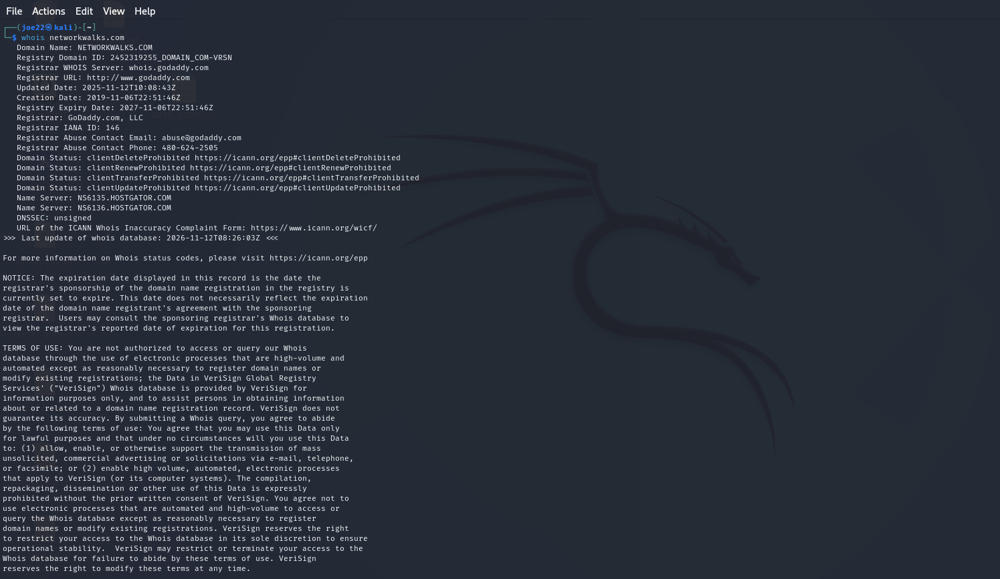
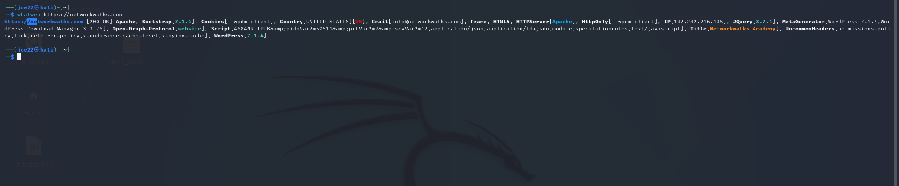
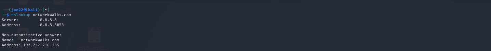
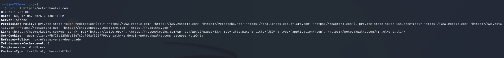
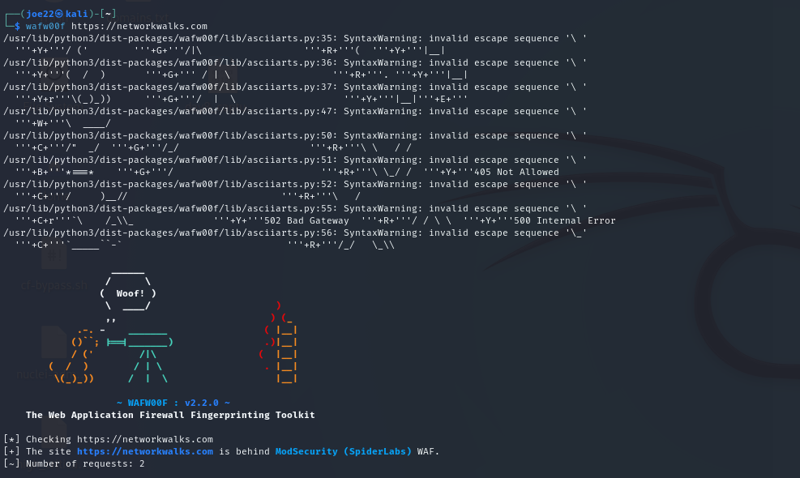
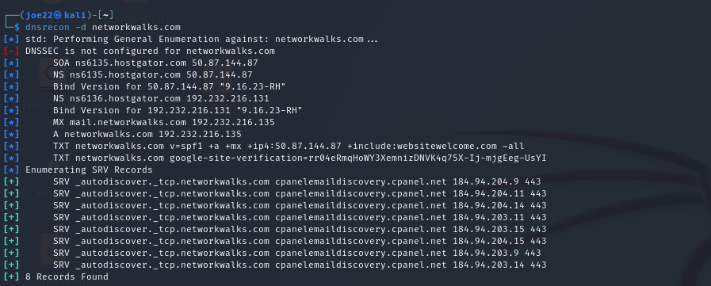
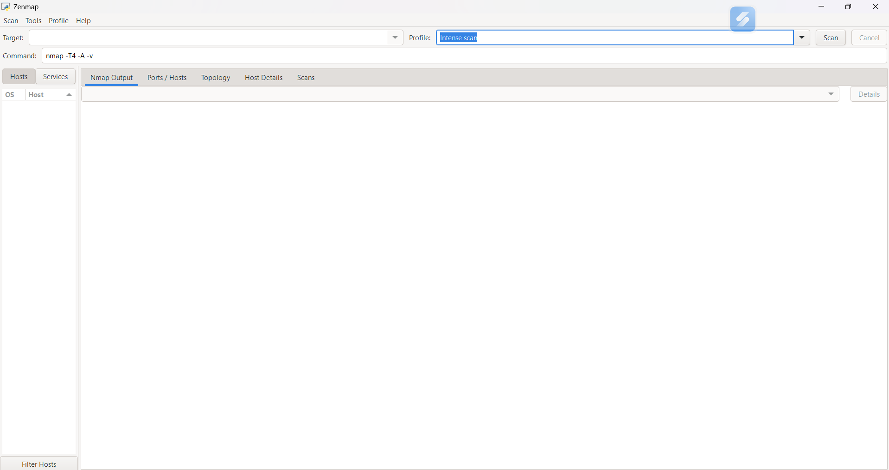
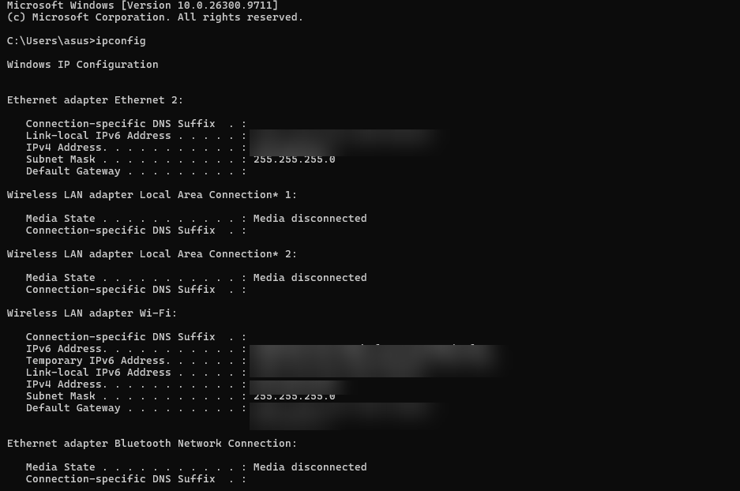
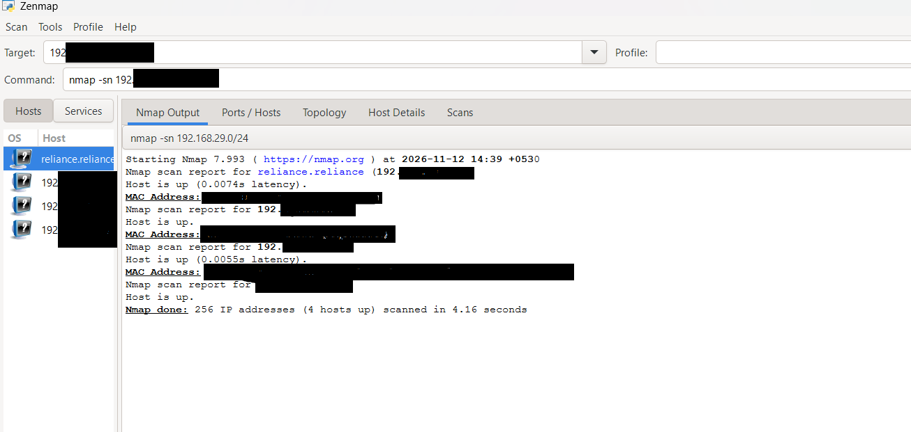
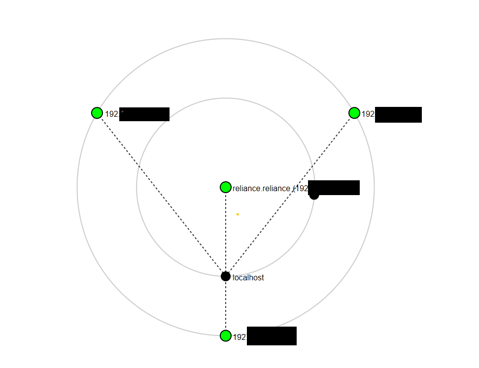

# 🔐 NetworkWalks B084 – Week 2 Cybersecurity Internship

**Practical Footprinting with Kali Linux & Network Scanning with Zenmap**

## 📌 Project Overview

This repository documents my Week 2 hands-on cybersecurity internship activities with NetworkWalks. The work focuses on information gathering, domain footprinting, website technology identification, DNS enumeration, Web Application Firewall (WAF) detection, and local network discovery.

The practical work covers two modules:

- **W2-PM1:** Footprinting using Kali Linux tools
- **W2-PM5:** Network scanning and host discovery using Zenmap (Nmap)

All activities were performed for educational purposes, using the assigned training target for footprinting and my own local network for scanning.

---

## 🎯 Objectives

- Understand the fundamentals of domain footprinting and reconnaissance.
- Gather publicly available domain and DNS information.
- Identify website technologies and HTTP response headers.
- Detect the presence of a Web Application Firewall.
- Understand how DNS enumeration works.
- Install and use Zenmap for network scanning.
- Identify active hosts on a local network.
- Visualize discovered hosts using network topology.

---

# 🔍 W2-PM1: Footprinting Using Kali Linux

## 1. WHOIS – Domain Information Gathering

**Tool:** WHOIS

**Command:**
```bash
whois networkwalks.com
```

**Description:**

WHOIS is a command-line utility used to retrieve publicly available domain registration information. It can provide details such as registrar information, domain creation and expiration dates, registration status, and name servers, depending on the information made publicly available.

**Objective:**
To understand how domain registration information can support the initial reconnaissance phase of a security assessment.

**Screenshot – WHOIS Output:**



---

## 2. WhatWeb – Website Technology Identification

**Tool:** WhatWeb

**Command:**
```bash
whatweb https://networkwalks.com
```

**Description:**

WhatWeb is a website fingerprinting tool used to identify technologies used by a website. It can detect information such as web server software, frameworks, content management systems, JavaScript libraries, and other publicly identifiable technologies.

**Objective:**
To observe how website technology fingerprinting helps security analysts understand a website's publicly exposed technology stack.

**Screenshot – WhatWeb Output:**



---

## 3. NSLookup – DNS Information Gathering

**Tool:** NSLookup

**Command:**
```bash
nslookup networkwalks.com
```

**Description:**

NSLookup is a network administration tool used to query DNS servers. It helps retrieve DNS records and resolve domain names into IP addresses.

**Objective:**
To understand the relationship between domain names and IP addresses and learn how DNS queries support reconnaissance.

**Screenshot – NSLookup Output:**



---

## 4. cURL – HTTP Response Header Analysis

**Tool:** cURL

**Command:**
```bash
curl -I https://networkwalks.com
```

**Description:**

cURL is a command-line tool used to transfer data to and from servers. The `-I` option requests HTTP response headers without downloading the complete webpage.

HTTP response headers can provide useful information about server responses, content types, caching, redirects, and security-related configurations.

**Objective:**
To inspect HTTP response headers and understand how servers communicate response information to clients.

**Screenshot – HTTP Response Headers:**



---

## 5. WAFW00F – Web Application Firewall Detection

**Tool:** WAFW00F

**Command:**
```bash
wafw00f https://networkwalks.com
```

**Description:**

WAFW00F is a tool used to identify whether a website is protected by a Web Application Firewall (WAF). It sends HTTP requests and analyzes the responses to identify possible firewall technologies.

**Observed Result:**

The tool identified the website as being behind **ModSecurity (SpiderLabs) WAF**.

**Objective:**
To understand how WAF detection works and why web application firewalls are important for protecting web applications against malicious HTTP requests.

**Screenshot – WAFW00F Output:**



---

## 6. DNSRecon – DNS Enumeration

**Tool:** DNSRecon

**Command:**
```bash
dnsrecon -d networkwalks.com
```

**Description:**

DNSRecon is a DNS enumeration tool used to gather information about a target domain. It can perform DNS record enumeration and other DNS-related checks.

**Objective:**
To explore DNS enumeration and understand how DNS records can provide useful information during the reconnaissance phase.

**Screenshot – DNSRecon Output:**



---

## 📊 W2-PM1: Tools Summary

| Tool | Purpose |
|---|---|
| WHOIS | Domain registration information |
| WhatWeb | Website technology fingerprinting |
| NSLookup | DNS lookup and name resolution |
| cURL | HTTP response header analysis |
| WAFW00F | Web Application Firewall detection |
| DNSRecon | DNS enumeration |

**Learning Outcome:**

Through this module, I gained practical experience with six Kali Linux tools used in reconnaissance and footprinting. I learned how domain information, DNS records, website technologies, HTTP headers, and WAF identification can contribute to the information-gathering phase of a security assessment.

---

# 🌐 W2-PM5: Network Scanning Using Zenmap

## 1. Zenmap Installation

**Tool:** Zenmap (Nmap GUI)

**Description:**

Zenmap is the graphical user interface for Nmap. It allows users to configure scans, execute network discovery tasks, review scan results, and visualize network topology.

**Objective:**
To install Zenmap and understand its interface before performing network scanning.

**Screenshot – Zenmap Installation:**



---

## 2. Identifying Local Network Configuration

**Tool:** Windows Command Prompt

**Command:**
```cmd
ipconfig
```

**Description:**

The `ipconfig` command displays the network configuration of a Windows computer. It provides information such as IPv4 address, subnet mask, and default gateway.

This information helps identify the local network range before performing an authorized network scan.

**Objective:**
To identify the local network configuration and determine the appropriate subnet for the scan.

**Screenshot – IP Configuration:**



---

## 3. Performing a Ping Scan Using Zenmap

**Tool:** Zenmap (Nmap)

**Scan Type:** Ping Scan

**Target Network:**
```text
192.XXX.XX.X/XX
```

**Description:**

A Ping Scan is used to discover which hosts appear to be active on a network. It helps identify reachable devices without performing a full port scan.

For this practical exercise, I performed a Ping Scan on my own local network using Zenmap.

**Objective:**
To discover active hosts on the local network and understand how network discovery works.

**Observed Results:**

- Network range scanned: `/24`
- Total IP addresses scanned: 256
- Active hosts discovered: 4
- Scan duration: Approximately 4.16 seconds

**Screenshot – Zenmap Ping Scan Results:**



---

## 4. Network Topology Visualization

**Tool:** Zenmap

**Description:**

Zenmap provides a topology view that visually represents discovered hosts and their network relationships. This view helps users understand the structure of a scanned network.

**Objective:**
To review the discovered hosts through Zenmap's topology visualization.

**Screenshot – Network Topology:**



---

## 📊 W2-PM5: Activity Summary

| Activity | Description |
|---|---|
| Zenmap Installation | Installed and opened the Zenmap interface |
| IP Configuration | Identified local network settings using `ipconfig` |
| Ping Scan | Scanned the authorized local `/24` network |
| Host Discovery | Identified 4 active hosts |
| Topology View | Visualized discovered hosts in Zenmap |

**Learning Outcome:**

This module provided practical experience in network discovery using Zenmap. I learned how to identify a local network range, perform a Ping Scan, interpret discovered hosts, and visualize network topology.

---

# 🎬 YouTube Lab Demonstration

Watch the complete Week 2 hands-on cybersecurity lab demonstration:

[▶️ Watch Week 2 Lab Demonstration on YouTube](https://youtu.be/Dd6vxXAMRZo)

The video demonstrates the practical activities performed in both modules, including Kali Linux footprinting tools and Zenmap network scanning.

---

# 🛠️ Tools & Technologies Used

- Kali Linux
- WHOIS
- WhatWeb
- NSLookup
- cURL
- WAFW00F
- DNSRecon
- Zenmap
- Nmap
- Windows Command Prompt

---

# 📚 Key Learnings

- Practical understanding of domain footprinting and reconnaissance.
- Website technology identification using WhatWeb.
- DNS lookup and enumeration techniques.
- HTTP response header inspection.
- Understanding Web Application Firewall detection.
- Local network configuration and subnet identification.
- Host discovery using Zenmap and Nmap.
- Network topology visualization.

---

# ⚠️ Disclaimer

This repository is intended strictly for educational and cybersecurity learning purposes.

Footprinting activities were performed against the assigned training domain, and network scanning was restricted to my own local network.

Always obtain proper authorization before performing reconnaissance, scanning, or security testing on any system or network.

---

## 👨‍💻 Author

**Devkrishna Nagda**

Cybersecurity Intern | NetworkWalks B084

GitHub: [@devkrishnanagda22](https://github.com/devkrishnanagda22)

**Continuously learning, practicing, and building cybersecurity skills.** 🔐
